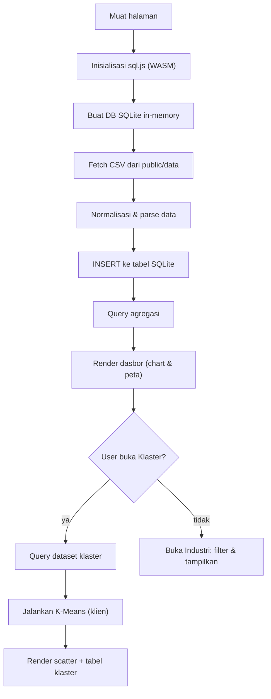

# PRD — Dasbor Analitik UMKM & Ekonomi Lokal

## 1. Gambaran Produk
Dasbor analitik UMKM, koperasi, industri, dan pasar Kabupaten Banjarnegara berbasis web. Mengambil data CSV dari folder Dinas DISPERINDAGKOP UKM (dan BPS untuk konteks makro), menyimpannya di SQLite yang berjalan di browser (sql.js), lalu memvisualisasikan serta menganalisa untuk mendukung perencanaan pembinaan berbasis data.
- Tujuan utama: memberi Dinas Koperasi/UMKM, analis kebijakan, dan pemda gambaran potensi ekonomi lokal per kecamatan secara interaktif.
- Nilai: identifikasi klaster potensi, kesenjangan pembiayaan, dan komoditas unggulan — sebagai dasar rekomendasi pembinaan.

## 2. Fitur Inti

### 2.2 Modul Fitur
1. **Dasbor**: ringkasan eksekutif — stat cards, tren koperasi aktif, top industri, breakdown per kecamatan.
2. **Klaster**: pengelompokan kecamatan via K-Means berdasarkan dimensi UMKM.
3. **Industri**: eksplorasi daftar jenis industri + produksi/tenaga kerja/nilai investasi lintas tahun dengan filter.

### 2.3 Detail Halaman
| Nama Halaman | Modul | Deskripsi Fitur |
|---|---|---|
| Dasbor | Stat cards | Total koperasi aktif, total industri, total tenaga kerja UMKM, kontribusi PDRB (terbaru) |
| Dasbor | Tren koperasi | Line/bar chart jumlah koperasi aktif 2022–2024 per kecamatan |
| Dasbor | Top industri | Bar chart 10 industri teratas berdasarkan tenaga kerja / nilai investasi |
| Dasbor | Peta klaster | Leaflet + GeoJSON kecamatan dengan color-coding klaster potensi |
| Klaster | Kontrol K | Pilih k (2–5) & dimensi (koperasi/industri/tenaga kerja), re-run K-Means |
| Klaster | Scatter plot | Visualisasi hasil klaster + centroid |
| Klaster | Tabel kecamatan | Keanggotaan klaster + label prioritas (Tinggi/Menengah/Rendah) |
| Industri | Filter | Filter tahun + jenis industri + sort |
| Industri | Tabel & chart | Tabel paginasi + bar chart perbandingan tahun |

## 3. Proses Inti
Alur data: saat aplikasi dimuat, muat sql.js (WASM) → buat DB SQLite in-memory → fetch CSV dari `public/data` → normalisasi (bersihkan angka, seragamkan nama komoditas & kecamatan) → INSERT ke tabel → query untuk dashboard. K-Means dijalankan di sisi klien (JS) atas hasil query.

## 4. Desain Antarmuka

### 4.1 Gaya Desain
Mengikuti `style_guide.md` — **Neo-Brutalist / Retro-Industrial**:
- Sudut tegas `rounded-none`, border hitam `#141414` tebal, bayangan padat offset `2px 2px 0` / `4px 4px 0` (tanpa blur).
- Tipografi: `JetBrains Mono` (label/heading/angka, UPPERCASE + tracking lebar), `Inter` (teks isi), `Playfair Display` italic (aksen editorial).
- Kanvas `#f1f1ef` dengan tekstur grid halus; panel gelap `#141414`.
- Aksen fungsional: biru=aktif/highlight, merah=alert/prioritas tinggi, amber=peringatan, indigo=AI.
- Kartu: `bg-white border border-[#141414] shadow-hd`.

### 4.2 Gambaran Desain Halaman
| Halaman | Modul | Elemen UI |
|---|---|---|
| Dasbor | Header sticky | Logo blok hitam + judul mono uppercase + jam live |
| Dasbor | Hero | Kicker mono, heading Playfair italic, lead, bar statistik 4 kolom |
| Dasbor | Grid kartu | Kartu border tebal + shadow-hd, hover translate -2/-2 + shadow 6px |
| Klaster | Kontrol | Input/select border-slate-900, tombol primer bg-hitam mono uppercase |
| Industri | Tabel | Header dark, baris border-hd-subtle, badge status mono 9px |

### 4.3 Responsif
Desktop-first, grid adaptif `auto-fill minmax(300px,1fr)`, statistik 4→2 kolom di mobile.

## 5. Catatan Data
- Sumber CSV: `I:\analiotik\master data\EXCEL + CSV\EXCEL + CSV\15. DISPERINDAGKOP UKM\` (koperasi aktif, koperasi+SHU, pasar, industri, sarana perdagangan) + `47. BPS\` (PDRB, pertumbuhan).
- Pipeline normalisasi wajib menangani: angka quote dengan pemisah ribuan (`"2,062"`), desimal koma (`" 211,5 "` → 211.5), inkonsistensi nama komoditas (`Tempe Kedelai`/`Tempe Kedelai`, `Gybsum`/`Gypsum`), dan normalisasi nama kecamatan (`Purwareja Klampok` dll.).
- File GeoJSON kecamatan disalin dari aplikasi Kemiskinan (`peta_kecamatan.geojson`) ke `public/geo/`.
