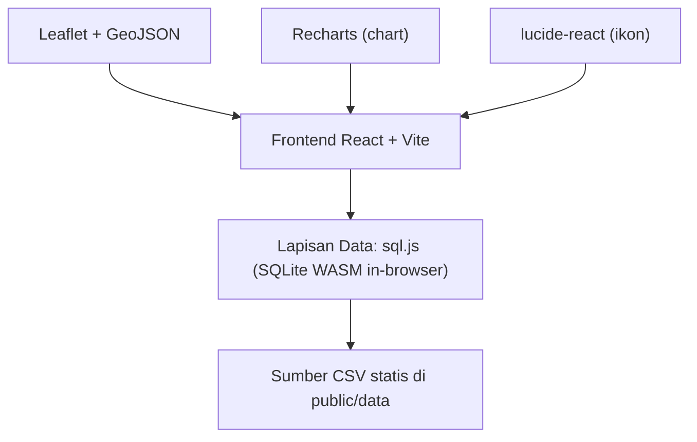
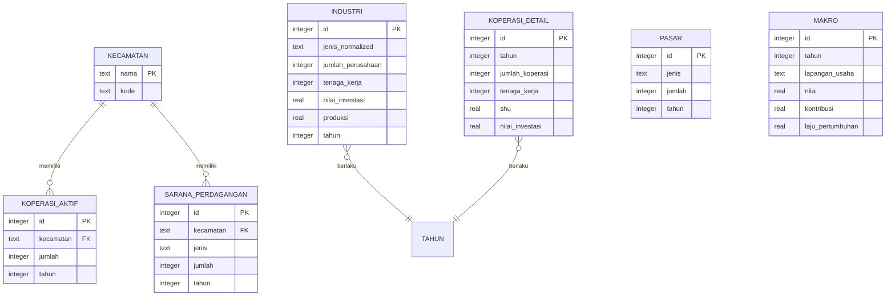

# Arsitektur Teknis — Dasbor Analitik UMKM

## 1. Desain Arsitektur


## 2. Deskripsi Teknologi
- Frontend: React 18 + Vite
- Styling: Tailwind CSS v4 via `@tailwindcss/vite` (gaya neo-brutalist dari `style_guide.md`)
- Data: **sql.js** (SQLite dikompilasi ke WASM, berjalan 100% di browser) — tanpa backend
- CSV: disalin ke `public/data/` agar dapat di-fetch; diparse di klien lalu di-INSERT ke SQLite
- Chart: Recharts
- Peta: Leaflet + GeoJSON kecamatan
- Ikon: lucide-react
- Font: Google Fonts (Inter, JetBrains Mono, Playfair Display)

## 3. Definisi Rute
| Rute | Tujuan |
|---|---|
| `/` | Dasbor utama (statistik, tren, top industri, peta klaster) |
| `/klaster` | Analisa K-Means per kecamatan |
| `/industri` | Eksplorasi daftar industri + filter |

## 4. Definisi API
Tidak ada API eksternal. Semua akses data melalui modul `src/lib/db.ts` yang membungkus sql.js dengan fungsi query terstruktur (mis. `getKoperasiTren()`, `getTopIndustri(tahun, limit)`, `getKlasterDataset()`).

## 5. Data Model

### 5.1 Definisi Model Data


### 5.2 Data Definition Language
```sql
CREATE TABLE kecamatan (
  nama TEXT PRIMARY KEY,
  kode TEXT
);

CREATE TABLE koperasi_aktif (
  id INTEGER PRIMARY KEY AUTOINCREMENT,
  kecamatan TEXT REFERENCES kecamatan(nama),
  jumlah INTEGER,
  tahun INTEGER
);
CREATE INDEX idx_kopaktif_tahun ON koperasi_aktif(tahun);

CREATE TABLE industri (
  id INTEGER PRIMARY KEY AUTOINCREMENT,
  jenis_normalized TEXT,
  jenis_raw TEXT,
  jumlah_perusahaan INTEGER,
  tenaga_kerja INTEGER,
  nilai_investasi REAL,
  produksi REAL,
  tahun INTEGER
);
CREATE INDEX idx_industri_tahun ON industri(tahun);
CREATE INDEX idx_industri_jenis ON industri(jenis_normalized);

CREATE TABLE koperasi_detail (
  id INTEGER PRIMARY KEY AUTOINCREMENT,
  tahun INTEGER,
  jumlah_koperasi INTEGER,
  tenaga_kerja INTEGER,
  shu REAL,
  nilai_investasi REAL
);

CREATE TABLE pasar (
  id INTEGER PRIMARY KEY AUTOINCREMENT,
  jenis TEXT,
  jumlah INTEGER,
  tahun INTEGER
);

CREATE TABLE sarana_perdagangan (
  id INTEGER PRIMARY KEY AUTOINCREMENT,
  kecamatan TEXT REFERENCES kecamatan(nama),
  jenis TEXT,
  jumlah INTEGER,
  tahun INTEGER
);

CREATE TABLE makro (
  id INTEGER PRIMARY KEY AUTOINCREMENT,
  tahun INTEGER,
  lapangan_usaha TEXT,
  nilai REAL,
  kontribusi REAL,
  laju_pertumbuhan REAL
);
```

## 6. Modul Kode (rencana struktur)
- `src/lib/sql-wasm/` — asset WASM sql.js
- `src/lib/db.ts` — inisialisasi sql.js, skema, import CSV
- `src/lib/normalize.ts` — pembersihan angka, pemetaan nama komoditas & kecamatan
- `src/lib/kmeans.ts` — implementasi K-Means (k=2–5)
- `src/components/` — kartu, header, badge, chart wrapper sesuai style guide
- `src/pages/` — Dasbor, Klaster, Industri
- `public/data/*.csv` — CSV sumber
- `public/geo/peta_kecamatan.geojson` — batas kecamatan
